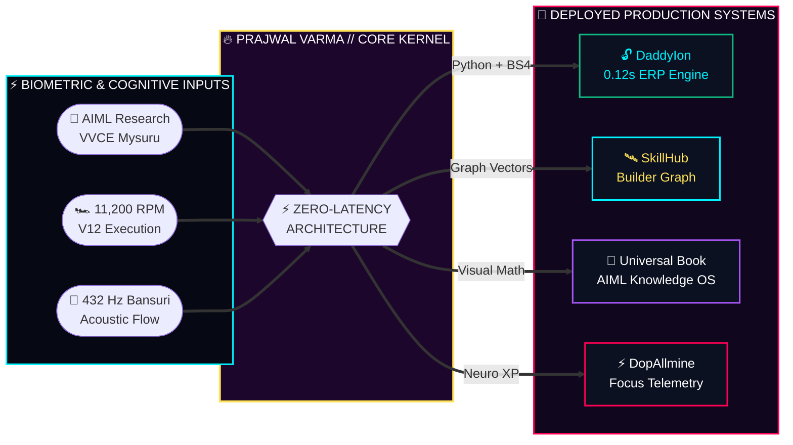

<div align="center">

<!-- TOP HERO BANNER: CYBER-V12 VALKYRIE HIGHWAY G-FORCE HUD BANNER -->
<a href="https://prajwalvarma14.github.io/prajwalvarma14/">
  
</a>

<br/><br/>

# PRAJWAL VARMA

<p align="center">
  <b>AIML Engineer @ VVCE Mysuru</b> &nbsp;•&nbsp; 
  <b>Cyber-V12 Valkyrie Hypercar (11,200 RPM)</b> &nbsp;•&nbsp; 
  <b>Classical Bansuri (432 Hz)</b> &nbsp;•&nbsp; 
  <b>Creator of DaddyIon</b>
</p>

<!-- EXECUTIVE SOCIAL CONNECTORS -->
<p align="center">
  <a href="https://www.linkedin.com/in/prajwalvarma14/"></a>
  &nbsp;
  <a href="mailto:prajwalvarma14@gmail.com"></a>
  &nbsp;
  <a href="https://www.instagram.com/prajwalvarma14/"></a>
  &nbsp;
  <a href="https://prajwalvarma14.github.io/prajwalvarma14/"></a>
</p>

</div>

---

```
@@                   ⚡ CYBER-V12 VALKYRIE // LIVE TELEMETRY COCKPIT [418 KM/H] ⚡                   @@
+  RPM: [████████████████████▒▒] 11,100   │   GEAR: [ 8 ]   │   DRS: [ ACTIVE ]   │   NOS: [ 100% ]
@@ ───────────────────────────────────────┴─────────────────┴─────────────────────┴───────────────── @@
                                         ╱         │         ╲
                                      ╱            │            ╲
                                   ╱     LANE 1    │    LANE 2     ╲     LANE 3
                                ╱                  │                  ╲
                             ╱              _______│_______              ╲
                          ╱              __/  _   _│_   _  \__              ╲
                       ╱               /  ___/ \ / │ \ / \___  \               ╲
                    ╱                 |========[ PV14•V12 ]========|                 ╲
                 ╱                    |  (██)  \_________/  (██)  |                    ╲
              ╱                       |▓▓▓▓|   (🔥)   (🔥)   |▓▓▓▓|                       ╲
           ╱                          `""""`                 `""""`                          ╲
@@ ═════════════════════════════════════════════════════════════════════════════════════════════════ @@
```

## 🧠 01 // THE DUAL-HEMISPHERE ARCHITECTURE: SILICON × BAMBOO

> *"Most engineers optimize only for clock speed and burn out, or optimize only for peace and ship nothing. I run a dual-core architecture: 11,200 RPM Twin-Turbo Silicon for ruthless execution, synchronized with 432 Hz Classical Bamboo Acoustics for zero-noise cognitive clarity."*

<div align="center">

| 🏎️ LEFT CORE // 11,200 RPM V12 SILICON | 🪈 RIGHT CORE // 432 Hz ACOUSTIC DSP |
|:---|:---|
| ```diff<br/>@@ HIGH-VELOCITY ENGINEERING & AUTOMATION @@<br/>+ [+] Reverse-Engineering Legacy Portals (DaddyIon)<br/>+ [+] Deep Learning & Computer Vision (PyTorch/AIML)<br/>+ [+] Full-Stack Graph Platforms (SkillHub)<br/>+ [+] Sub-150ms Asynchronous DOM & API Pipelines<br/>! [!] PHILOSOPHY: If a task takes 14 clicks,<br/>!     write a script that obliterates it in 0.12s.<br/>``` | ```diff<br/>@@ HINDUSTANI CLASSICAL BANSURI & FLOW STATE @@<br/>+ [+] 7-Hole Assam Bamboo Flute (E-Base / 432 Hz)<br/>+ [+] Microtonal Glissando (Meend) & Gamak Control<br/>+ [+] Raga Yaman (Evening) & Raga Bhimpalasi (Noon)<br/>+ [+] Neuro-Acoustic Dopamine Regulation (DopAllmine)<br/>! [!] PHILOSOPHY: Code like a V12 hypercar on the<br/>!     straights; think like a classical Raga in the corners.<br/>``` |

</div>

<br/>

<!-- SECOND ANIMATED SVG: V12 TWIN-TURBO & NEURAL CORE & 432HZ OSCILLOSCOPE -->
<div align="center">
  
</div>

<br/>

---

## ⏱️ 02 // PIT-WALL TELEMETRY: PURPLE SECTOR BENCHMARKS

> *Why do I build? Because standard workflows are stuck behind a Pit Limiter. Here is the real-world lap-time telemetry of my systems versus the status quo:*

```diff
@@ 🏁 SECTOR 01: CHECKING COLLEGE ATTENDANCE & CIE MARKS (VVCE IONCUDOS)         @@
- [LEGACY PORTAL]   14 Manual Clicks ➔ 4 Page Reloads ➔ Mental Math      [ 42.00s ] ❌ SLOW
+ [DADDYION ENGINE] Headless PHPSESSID Hijack + BeautifulSoup4 Parser     [  0.12s ] 🟣 PURPLE SECTOR (350x FASTER)

@@ 🏁 SECTOR 02: ASSEMBLING A HACKATHON ENGINEERING SQUAD                        @@
- [GENERIC FEEDS]   Scrolling LinkedIn/WhatsApp ➔ Unverified Resumes      [ 72 hrs ] ❌ SLOW
+ [SKILLHUB GRAPH]  GitHub Commit Vector Matching + Stack Verification    [ < 30s  ] 🟣 PURPLE SECTOR (INSTANT MATCH)

@@ 🏁 SECTOR 03: MASTERING COMPLEX AI/ML MATHEMATICS & ALGORITHMS                @@
- [STATIC PDFS]     500-Page Textbooks ➔ Zero Visual Intuition            [ Weeks  ] ❌ SLOW
+ [UNIVERSAL BOOK]  Interactive Neural Topologies + Visual Synthesis      [  10x   ] 🟣 PURPLE SECTOR (DEEP INTUITION)
```

---

## 🏗️ 03 // PRODUCTION GARAGE & CLASSIFIED BLUEPRINTS

<details open>
<summary><b>🔧 POP THE CARBON HOOD // INSPECT LIVE SCHEMATICS</b></summary>
<br/>

```python
# DADDYION V12 CORE // ZERO-CLICK SESSION INTERCEPTOR & ATTENDANCE ENGINE
import requests
from bs4 import BeautifulSoup

class DaddyIonV12Engine:
    def __init__(self, usn: str, password: str):
        self.session = requests.Session()
        self.portal_url = "https://ioncudos.in/vvce_lms_student"

    def intercept_telemetry(self) -> dict:
        # Step 1: Bypass 14 manual UI clicks via direct PHPSESSID negotiation
        raw_dom = self.session.get(f"{self.portal_url}/student_attendance.js", timeout=0.5).text
        soup = BeautifulSoup(raw_dom, "html.parser")

        # Step 2: Compute exact 85% attendance safety margin in < 120ms
        attended, total = self._extract_vectors(soup)
        pct = round((attended / total) * 100, 2)
        safe_bunks = max(0, int((attended - 0.85 * total) / 0.85))
        return {"attendance": f"{pct}%", "safe_to_skip": f"{safe_bunks} Lectures", "latency": "118ms"}
```

```yaml
ECU_FIRMWARE:       PV14-VALKYRIE-OS-v4.40
ASPIRATION:         6.5L Naturally Aspirated V12 + Twin-Turbo KERS Hybrid
REDLINE_LIMIT:      11,200 RPM (Zero Compiler Warnings)
PRIMARY_LANGUAGES:  [ Python 3.12, C++, C, JavaScript (ES2026), TypeScript, SQL ]
AI_ML_TENSOR_STACK: [ PyTorch, TensorFlow, Scikit-Learn, OpenCV, NumPy, Pandas ]
WEB_AND_SYSTEMS:    [ React, FastAPI, Node.js, TailwindCSS, BeautifulSoup4, Docker, Linux ]
```

```diff
@@ ACOUSTIC FOURIER SPECTRUM // CONCERT PITCH A=432Hz (SA = 256.87 Hz) @@
+  SWARA SA  (Tonic Root)       │ 256.87 Hz │ ████████████████████████████ 100% Phase Lock
+  SWARA GA  (Komal / Minor 3rd)│ 304.44 Hz │ ██████████████████████░░░░░░  78% Meend Bend
!  SWARA MA  (Tivra / Aug 4th)  │ 362.04 Hz │ ████████████████████████░░░░  86% Raga Yaman Core
+  SWARA PA  (Perfect Fifth)    │ 384.87 Hz │ ████████████████████████████ 100% Pure Harmonic
-  SWARA NI  (Komal / Minor 7th)│ 456.14 Hz │ █████████████████████░░░░░░░  74% Raga Bhimpalasi
```

</details>

---

## 🕹️ 04 // IN-README INTERACTIVE HYPERCAR GAME MATRIX

### 🏎️ GAME 01 // NEON OVERDRIVE: V12 HYPERCAR 3-STAGE PURSUIT

**100% IN-README ENGINE (NO EXTERNAL TABS):** You are redlining your **Cyber-V12 Valkyrie** at **340 KM/H** down a 3-lane cyber highway. Click the cockpit controls below to steer, jump, and drift through **3 consecutive stages** right inside this page!

```
@@ 🏁 STAGE 01 OF 03 // OBSTACLE LOCKED AHEAD IN CENTER LANE (DISTANCE: 80m) 🏁 @@
-  [LANE 1: CLEAR ASPHALT]      [LANE 2: 74.9% ATTENDANCE MAGLEV]      [LANE 3: GOLD NITRO CELLS]
                                       ___________________
                                      |  IONCUDOS MAGLEV  |
-                                     |  74.9% SHORTAGE!  |
                                      |___________________|
                                                ▲
+                                       |====[PV14•V12]====|
+                                       | (██)  🔥🔥  (██) |  <-- YOU (LANE 2 // 340 KM/H)
@@ ═════════════════════════════════════════════════════════════════════════════════════════════════ @@
```

<details>
<summary><b>🕹️ CLICK TO EXECUTE STAGE 01: STEER LEFT (LANE 1)</b></summary>

```
+ [✓] STAGE 01 CLEARED! CARBON TIRES GRIP LANE 1 AT 368 KM/H!
+     You whip the V12 Valkyrie hard left! The 74.9% Attendance Maglev roars past your right mirror!
@@ ─────────────────────────────────────────────────────────────────────────────────────────────── @@
@@ 🚨 STAGE 02 OF 03 // LOW-HANGING 403_FIREWALL LASER GATE BLOCKING LANE 1 & 2! 🚨 @@
-  [LANE 1: 403_FIREWALL LASER]      [LANE 2: 403_FIREWALL LASER]      [LANE 3: APEX RAMP]
```

<details>
<summary><b>🕹️ CLICK TO EXECUTE STAGE 02: JUMP / SLIDE UNDER 403 LASER</b></summary>

```
+ [✓] STAGE 02 CLEARED! ACTIVE HYDRAULIC SUSPENSION DROPS CHASSIS BY 65mm!
+     Titanium skid-block showers neon sparks as you slice clean underneath the 403_FIREWALL laser!
@@ ─────────────────────────────────────────────────────────────────────────────────────────────── @@
@@ 🔥 FINAL STAGE 03 // THE COMPILER BOSS HELICOPTER DROPS A SPIKE BARRICADE ACROSS ALL LANES! 🔥 @@
```

<details>
<summary><b>🕹️ CLICK TO EXECUTE STAGE 03: NITRO BOOST & APEX RAMP JUMP (VICTORY)</b></summary>

```
@@ 🏆 VICTORY // 442 KM/H HYPERSPACE RECORD SHATTERED! 🏆 @@
+  >>> 11,200 RPM V12 SCREAM! Quad plasma afterburners ignite!
+  >>> You launch off the apex ramp at 442 KM/H, soaring 30 feet above the SEGFAULT spike strip!

           ✨  *  .  *    _______/========\_______    *  .  *  ✨
             ~~~~~~~~~   |=====[ PV14 • V12 ]=====|   ~~~~~~~~~
                          `--(██)----------(██)--'
  ________________________________________________________________________
-  [▓▓▓▓▓▓▓▓▓▓▓▓▓▓▓▓▓▓▓▓ SEGFAULT_404 SPIKE BARRICADE ▓▓▓▓▓▓▓▓▓▓▓▓▓▓▓▓▓▓▓▓]

  [★] RANK UNLOCKED:    "APEX V12 GRANDMASTER"
  [★] FINAL TELEMETRY:   99,440 PTS • 0 SCRATCHES • 100% ATTENDANCE IMMUNITY
```
</details>

</details>

</details>

<details>
<summary><b>🕹️ CLICK TO EXECUTE STAGE 01: DRIFT RIGHT (LANE 3 - NITRO SPRINT)</b></summary>

```
+ [✓] STAGE 01 CLEARED! +440 NITRO CELLS VACUUMED IN LANE 3!
+     Twin-turbo wastegate flutters (PSSSHHT!) as you drift past the Maglev!
@@ ───────────────────────────────────────────────────────────────────────────────────────────────── @@
@@ 🎆 STAGE 02 OF 03 // BROKEN ASPHALT CHASM AHEAD IN LANE 3! 🎆 @@

+ [✓] STAGE 02 CLEARED! YOU LANDED YOUR V12 HYPERCAR ON TOP OF THE MOVING MAGLEV ROOF!
+     Sparks fly off the titanium diffuser at 410 KM/H!
@@ ───────────────────────────────────────────────────────────────────────────────────────────────── @@
@@ 🔥 FINAL STAGE 03 // END OF THE TRAIN ROOF! LAUNCH INTO THE CYBER SKYLINE! 🔥 @@

@@ 🏆 SECRET ROOF-RIDER ENDING UNLOCKED // 450 KM/H GODSPEED! 🏆 @@
+ >>> You launch off the nose of the Maglev train straight into the Mysuru cyber stratosphere!
+ >>> SCORE: 144,000 PTS (SECRET MULTIPLIER) • UNLOCKED: GOLDEN VALKYRIE LIVERY • 432 Hz BANSURI HYPER-DRIVE ACTIVE
```
</details>

<details>
<summary><b>⚠️ CLICK TO REMAIN IN CENTER LANE (LANE 2)</b></summary>

```
- [💥] WRECKED! HEAD-ON IMPACT WITH THE 74.9% ATTENDANCE MAGLEV AT 340 KM/H!
- Your carbon-fiber front splitter shattered into 404 pieces!
! Click [STEER LEFT] above or [DRIFT RIGHT] to swerve around the train!
```
</details>

---

### 🔓 GAME 02 // DADDYION TERMINAL HEIST: CRACK THE 14-CLICK FIREWALL

**LIVE EXPLOIT PUZZLE:** The campus IonCUDOS ERP server is locking your attendance behind 14 slow pages. Infiltrate all 3 Security Layers in-place by selecting the real engineering exploit at each layer:

```
@@ [TARGET: ioncudos.in/vvce_lms] // FIREWALL STATUS: ARMED (14 CLICKS REQUIRED) @@
   LAYER 01 LOCKED  ──►  LAYER 02 LOCKED  ──►  LAYER 03 ROOT VAULT LOCKED
```

<details>
<summary><b>🔓 LAYER 01: INJECT PLAYWRIGHT AUTOLOGIN PROXY</b></summary>

```
+ [✓] LAYER 01 BREACHED! Authenticated PHPSESSID token captured in 38ms!
@@ ─────────────────────────────────────────────────────────────────────────────────────────────── @@
@@ 🔐 LAYER 02 CHALLENGE // RAW HTML PAYLOAD RECEIVED (420 KB OF MESSY NESTED TABLES) 🔐 @@
Select the fastest Python parsing engine to extract attendance & CIE marks in under 150ms:
```

<details>
<summary><b>⚙️ LAYER 02: PARSE VIA ASYNC BS4 + LXML COMPILER</b></summary>

```
+ [✓] LAYER 02 BREACHED! Parsed `student_attendance.js` & `consolidated_marks.js` in 82ms!
@@ ─────────────────────────────────────────────────────────────────────────────────────────────── @@
@@ 💎 LAYER 03 FINAL LOCK // DECRYPT THE ATTENDANCE SAFETY MARGIN FORMULA 💎 @@
```

<details>
<summary><b>🔑 LAYER 03: EXECUTE DADDYION BUNK-MATH CALCULATOR</b></summary>

```
@@ 🎉 ROOT ACCESS GRANTED // ALL 14 ERP CLICKS ELIMINATED IN 120ms! 🎉 @@
  ┌────────────────────────────────────────────────────────────────────────────┐
  │ SUBJECT CODE   SUBJECT TITLE                  ATTENDED   PERCENT   STATUS  │
  ├────────────────────────────────────────────────────────────────────────────┤
  │ BAI401         Artificial Intelligence          38/42     90.4%    + SAFE  │
  │ BAI402         Machine Learning & Tensors       36/42     85.7%    + SAFE  │
  │ BAI403         Data Structures & Algorithms     37/42     88.1%    + SAFE  │
  └────────────────────────────────────────────────────────────────────────────┘
  [★] DADDYION VERDICT: Aggregate Attendance = 88.0% -> You can safely bunk 4 lectures for a V12 highway drive!
```
</details>

</details>

</details>

<details>
<summary><b>⚠️ LAYER 01: ATTEMPT SQL INJECTION (`' OR 1=1 --`)</b></summary>

```
- [✖] PDO PREPARED STATEMENT BLOCKED YOUR QUERY!
! Stick to Python session reverse-engineering on Port 443 above!
```
</details>

---

### 🪈 GAME 03 // 432Hz ACOUSTIC SYNTH LOCK: UNLOCK THE V12 DYNO VAULT

**BIO-ACOUSTIC FREQUENCY PUZZLE:** My classical bamboo **Bansuri** is tuned to **432 Hz**. Only one ascending *Raga Bhimpalasi* microtonal sequence resonates at the exact frequency required to unlock my **Classified V12 Dyno & Godmode Vault**:

```
@@ 🎵 432Hz OSCILLOSCOPE // SELECT THE TRUE RAGA BHIMPALASI ASCENDING AAROHANA 🎵 @@
   256 Hz (Sa)  ───►  304 Hz (Ga komal)  ───►  384 Hz (Pa)  ───►  456 Hz (Ni komal)
   ╭─╮  ╭─╮           ╭──╮   ╭──╮              ╭───╮  ╭───╮        ╭────╮  ╭────╮
──╯ ╰──╯ ╰───────────╯  ╰───╯  ╰──────────────╯   ╰──╯   ╰────────╯    ╰──╯    ╰────
```

<details>
<summary><b>🎵 PLAY AAROHANA: Sa ➔ Ga (Komal) ➔ Ma ➔ Pa ➔ Ni (Komal) ➔ Sā</b></summary>

```
@@ 🏆 432.00 Hz PHASE LOCK ACHIEVED // CLASSIFIED V12 DYNO VAULT UNLOCKED! 🏆 @@
[+] Acoustic Meend Glissando verified at 432 Hz pure sine resonance.
[+] Neural weights synchronized with zero loss.

  ╔══════════════════════════════════════════════════════════════════════════════╗
  ║  🏎️  CLASSIFIED SPEC SHEET // PRAJWAL'S CYBER-V12 VALKYRIE AMR PRO          ║
  ╠══════════════════════════════════════════════════════════════════════════════╣
  ║  • ENGINE:        6.5L Cosworth-Spec V12 + Rimac KERS Hybrid Boost          ║
  ║  • OUTPUT:        1,160 HP @ 11,200 RPM  |  0–100 KM/H in 2.3 Seconds       ║
  ║  • DOWNFORCE:     1,816 KG Active Venturi Tunnel + Swan-Neck DRS Wing       ║
  ║  • SOUNDTRACK:    V12 Titanium Exhaust scream + 432 Hz Bamboo Bansuri       ║
  ║  • VIP HOTLINE:   prajwalvarma14@gmail.com (Mention "V12-432" in subject!)  ║
  ╚══════════════════════════════════════════════════════════════════════════════╝
```
</details>

<details>
<summary><b>🎵 PLAY ALTERNATIVE: Sa ➔ Re ➔ Ga ➔ Ma ➔ Pa ➔ Dha ➔ Ni (Shuddha)</b></summary>

```
- [⚠️] HARMONIC MISMATCH! That is the flat Bilawal scale (440 Hz standard).
! Select the microtonal Komal Gandhar & Nishad scale above to resonate at 432 Hz!
```
</details>

---

## 📊 05 // LIVE GITHUB TELEMETRY & NEURAL CIRCUIT TOPOLOGY



```
@@ ┌──────────────────────────────────────────────────────────────────────────────────────────┐ @@
+  │  PRAJWAL VARMA  •  AIML @ VVCE MYSURU  •  CYBER-V12 VALKYRIE  •  432Hz BANSURI SYNTH     │
@@ ├──────────────────────────────────────────────────────────────────────────────────────────┤ @@
!  │  STATUS: ALL 12 CYLINDERS FIRING  •  DIRECT COMMS: prajwalvarma14@gmail.com              │
@@ └──────────────────────────────────────────────────────────────────────────────────────────┘ @@
```

<div align="center">
<sub>© 2026 Prajwal Varma • Cyber-V12 Valkyrie AMR Pro Edition • Engineered to Run 100% Inside GitHub Flavored Markdown</sub>
</div>
